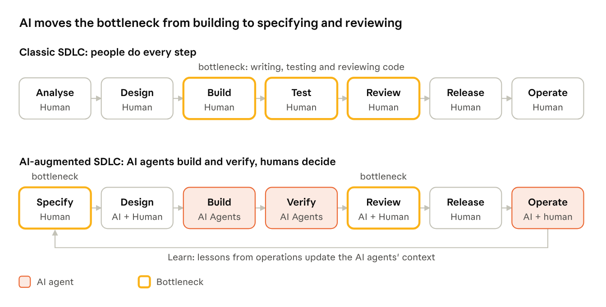
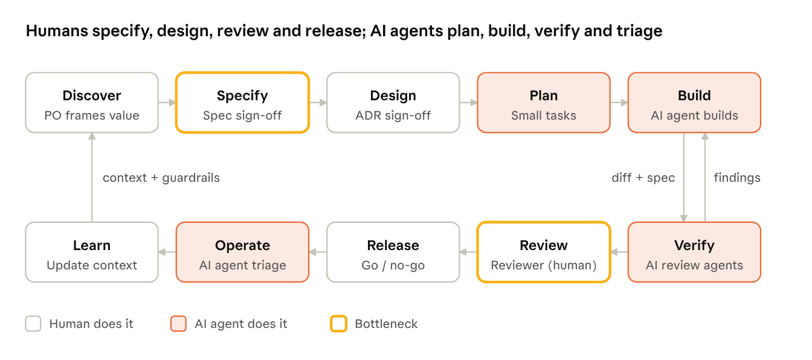

# Tasuki – AI SDLC

**AI-Augmented SDLC & Agile Operating Model**

Author: Resul Kocyigit · Current version: [PDF](Tasuki-AI-SDLC.pdf) · Last updated: 2026-11-14

> [!NOTE]
> **This is a living document.** AI is changing every area of work, and software delivery is no exception. Models, tools and practices move fast, so this operating model will keep changing as we learn. All thresholds and durations are starting hypotheses until they are validated with measured data. Changes are proposed and reviewed through pull requests.

> [!IMPORTANT]
> **Core assumption: a human stays in the loop.** AI agents can propose, build, test and review, but they cannot be held accountable for failures and incidents. Accountability for decisions, merges and releases therefore always stays with a named person (human).

## How this document was created

This document is based on my own research and my experience in software engineering and agile roles. I wrote the first version myself and then had Claude (Anthropic) and ChatGPT (OpenAI) challenge it. I decided on every proposal and change; Claude added the agreed text to the document. The overall idea, the criteria and the metrics come from my own research.

## Contents

- [How this document was created](#how-this-document-was-created)
- [Purpose & principles](#purpose--principles)
- [AI agent sandboxes and identities](#ai-agent-sandboxes-and-identities)
- [The workflow end to end](#the-workflow-end-to-end)
- [Phase detail: human vs agent](#phase-detail-human-vs-agent)
- [Adversarial review & verification layer](#adversarial-review--verification-layer)
- [Agile process: what changes](#agile-process-what-changes)
- [Tasuki: the agile way of working for the AI SDLC](#tasuki-the-agile-way-of-working-for-the-ai-sdlc)
- [Include / exclude](#include--exclude)
- [Metrics](#metrics)
- [Glossary](#glossary)
- [Create a PDF](#create-a-pdf)

## Purpose & principles

This target operating model focuses on every team that ships code to production, even when it is for internal use. It can also apply to infrastructure and platform engineering, where dependencies and operational complexity may require a different approach. Independent of team size, the principles of AI handling are the same.

As AI agents increasingly automate coding and testing, the bottleneck shifts toward specification and verification. However, the actual impact depends on the engineering environment. The SDLC below keeps humans on intent, decisions & accountability and gives AI agents the build, test and first-pass review work — with independent checks between every hand-off. This is a proposed target operating model, not an approved standard: all thresholds and durations are starting hypotheses until validated with measured data.



In the classic SDLC, people (human) do every step and the slow part is writing and testing code. In the AI-augmented SDLC, AI agents build and verify, so the slow parts become writing a precise spec and the PR reviewer's (human) review.

1.  **Spec is the implementation contract.** AI agents build and verify against approved, versioned specifications. A context-aware Spec Review Agent checks requirements against existing features and previous decisions, proposing improvements for human approval. Once approved, the specification is frozen for implementation. Any change stops the build until the revised specification is approved and the implementation is reassessed. The agent retains review history for future use.

2.  **Humans own decisions, AI agents own drafts.** Architecture is decided by the architect (human), risk by the PO and architect (human), merge by the PR reviewer (human) and release by the release owner (human). AI agents may propose, build, test and run first-pass review. For every human decision, AI agents still support it: they research options, compare trade-offs, flag risks and challenge assumptions, so the human decides with better input.

3.  **The author never grades its own work.** Every AI agent output is checked by something that did not produce it: a separate AI agent, an AI agent on a different model, the CI pipeline (automation), or a reviewer (human).

4.  **Automated checks provide repeatable verification.** Unit tests, integration tests, static analysis, and security scans run in CI. These are non-AI checks that give the same result every time. AI review adds another layer on top; it does not replace them.

5.  **Small batches, fast loops.** AI agents make large diffs cheap to produce, not cheap to review. Tasks are kept small and atomic in the Plan phase: one concern per task, normally ~1 day of AI agent work and ~400 changed lines. Risk, coupling and reviewability can justify exceptions. Smaller tasks produce fewer code changes, so each PR is atomic too and the PR reviewer (human) can review it properly. Big features are split into many small PRs.

6.  **Context is infrastructure.** Repo instructions (CLAUDE.md / AGENTS.md), skills, ADRs (Architecture Decision Records: short documents that record an architecture decision, its context and why it was chosen) and runbooks are maintained like code: AI agents propose updates, the architect (human) approves them. AI agent output quality depends on them (the context).

7.  **Everything is traceable.** Which AI agent and model version wrote the code, which spec and task it worked from, which AI review agents checked it and what they found, and which PR reviewer (human) approved the merge — the CI pipeline records all of this automatically for every PR. An auditor or an incident review can then trace any change back to its spec and its approver.

## AI agent sandboxes and identities

Every AI agent runs in its own sandbox with its own non-human identity, never with an engineer's (human) credentials. If an AI agent makes a mistake or is manipulated, the damage stays inside the sandbox.

The governed AI Infrastructure underneath (network, model catalog, cost controls, audit) is a prerequisite for this operating model.

| AI agent                  | Sandbox + Rights                                                                     |
|---------------------------|--------------------------------------------------------------------------------------|
| AI coding agent           | Own container + repo copy (worktree) per task; Write to its own branch only          |
| AI review agents          | Own container per run; Read diff + spec, run tests, post comments, no push, no merge |
| AI triage agent (Operate) | Own container per incident; Read logs and alerts, draft a fix PR                     |

| Rule                    | What it means                                                                                      |
|-------------------------|----------------------------------------------------------------------------------------------------|
| Identity                | One non-human identity per AI agent role, set up in the landing zone.                              |
| No stored secrets       | Short-lived credentials only; details are defined by the security department.                      |
| No production access    | No AI agent can merge, release or write to production.                                             |
| Logging                 | Every action and behavior is logged under the AI agent's identity, which also provides provenance. |
| Throw-away environments | Sandboxes start per run and are deleted afterwards (e.g. one CI job per AI agent).                 |
| AI cost awareness       | Each team estimates its expected AI cost consumption and plans a budget for its SDLC.              |

## The workflow end to end



Work moves from intent to production in ten phases. Humans hold the four principal decision gates: Specify, Design, Review, Release. Discover, Operate and Learn also end with a human check, but these steer the work rather than release it into the next phase.

## Phase detail: human vs agent

Each phase ends in a gate. A gate passes only on evidence, never on an AI agent saying it is done. Most gates pass automatically on evidence from the CI pipeline or the AI review agents; a human decides only where judgement or accountability is needed (see Gate type).

| Phase    | Human does                                                                                                                          | AI agent does                                                                                                   | Output                       | Gate (exit criteria)                                                                                                                                        | Gate type                                                                           |
|----------|-------------------------------------------------------------------------------------------------------------------------------------|-----------------------------------------------------------------------------------------------------------------|------------------------------|-------------------------------------------------------------------------------------------------------------------------------------------------------------|-------------------------------------------------------------------------------------|
| Discover | PO (human) frames problem, value, users. Translates the demand.                                                                     | Research, summarise, feedback/incidents, draft options                                                          | Problem or Value statement   | PO (human) accepts problem and/or value proposition                                                                                                         | Human                                                                               |
| Specify  | PO + architect (human) agree intent, acceptance criteria, non-goals (what is out of scope, so the AI agent adds no unasked changes) | Draft spec, edge cases, test scenarios; challenge gaps                                                          | Versioned spec (in repo)     | PO + architect (human) approve spec: testable, scoped, impact assessed                                                                                      | Human                                                                               |
| Design   | Architect (human) gives design context, decides and approves ADR                                                                    | Propose 2–3 designs, write the ADR, security assessment, impact analysis                                        | ADR, security assessment     | Architect and/or security engineer (AI+Human) sign off (high-impact changes only)                                                                           | Human (high-impact only)                                                            |
| Plan     | AI agent creates the plan from spec & ADR. The architect (human) reviews the plan for high-impact features only.                    | Create the plan per feature from the spec and ADR: break it into tasks, estimate blast radius, map dependencies | Task list linked to spec     | ~1 day AI agent work / ~400-line diff per task as reviewability heuristics, not hard limits; risk and coupling override                                     | Automatic; architect (human) check for high-impact features only; then Build starts |
| Build    | Engineer (human) monitors the AI agent, unblocks when the circuit breaker trips, ensures that agents can perform as expected.       | Implement in the respective environment, write tests first, runs in dev, test and locally.                      | Branch + tests               | All tests and linters green in CI pipeline                                                                                                                  | Automatic (CI pipeline)                                                             |
| Verify   | —                                                                                                                                   | AI review agents: finders, refuters, security review                                                            | Confirmed findings           | No unresolved confirmed high/critical findings from AI review agents; plausible critical findings investigated and dispositioned; evidence linked to the PR | Automatic (AI review agents)                                                        |
| Review   | PR reviewer (human) reviews diff against spec, owns merge                                                                           | Summarise PR, answer questions from the PR reviewer (human), fix findings                                       | Approved PR                  | Approval by PR reviewer (human); two reviewers for high-impact changes                                                                                      | Human                                                                               |
| Release  | Release owner (human) decides go/no-go                                                                                              | Release notes, rollback prep                                                                                    | Deployed version             | Rollback tested; low-impact changes automated only under a pre-approved policy, all others human go/no-go                                                   | Human; automatic for low-impact changes                                             |
| Operate  | On-call engineer (human) owns incidents and approves fixes                                                                          | AI triage agent reads logs and alerts, correlates incidents, drafts a fix PR                                    | Incident record, fix PR      | Fix goes through the normal flow (Review, Release)                                                                                                          | Human                                                                               |
| Learn    | Team (human) agrees practice changes                                                                                                | Mine reviews/incidents for recurring issues, update CLAUDE.md, skills, tests                                    | Updated context + guardrails | Architect (human) approves context changes like code                                                                                                        | Human                                                                               |

**Gate evidence.** Each gate adds its own evidence to one change record that travels with the change, so the record grows from the first gate to the last. At Release it contains all information.

**These could be:** change ID, spec/ADR version, impact level, data classification, AI agent and model versions, identity and tool permissions, test artifacts, findings and how they were handled, human decisions, deployment artifact digest, timestamps and policy version. Retention and access rules come from the organization's compliance policy.

## Adversarial review & verification layer

Adversarial review applies the red-team idea to code review. Finder AI agents act as the red team: they attack the code and assume it has bugs. Refute AI agents take the other side: they attack each finding and try to prove it wrong. Only findings that survive both sides are reported.

**AI review agents:** is the umbrella term for three roles: the finder looks for bugs, the refuter tries to disprove the findings, and the reporter deduplicates the surviving findings and posts them to the PR.

Verification runs in three layers (see below), cheapest (time & costs) first. A change reaches the PR reviewer (human) only after layers 1–2 (deterministic checks and critical AI agent review) pass, so human time goes to judgement, not to finding typos.

1.  **Deterministic checks** (CI pipeline, no AI) — build, unit/integration tests, type checks, linters, security scannings, dependency/license scan and other checks. No agent is involved here, because on each run it can answer differently.

2.  **Critical AI agent review (adversarial review)** — the pattern used on Claude Code's own PRs:

    1.  *Find:* start the review with one independent AI finder agent. Scale to 3–5 AI finder agents reading the diff in parallel only if measured data shows they catch more real bugs than they add in latency, cost and noise, each with one angle (correctness vs spec, security, performance, edge cases, maintainability).

    2.  *Refute:* every finding goes to a fresh AI refute agent told to prove it wrong against the real code. Cross-model check (high-impact changes only) *—* an AI finder agent on a different model family reviews the code the AI coding agent wrote, because models share blind spots within a family. This reduces correlated errors but does not guarantee correctness. Only reproducible or clearly argued findings survive.

    3.  *Report:* a reporting AI agent deduplicates the survivors, ranks them by severity and posts them to the PR as "confirmed" or "plausible".

3.  **Human review** — the PR reviewer (human) checks against the spec, not line by line: does it do what was asked, is the design right, is the risk acceptable.
    For high-impact changes the PR reviewer (human) also inspects auth, IAM, cryptography, network policy, data protection and infrastructure changes in detail.

**How findings are handled**

The categorisation of findings (severity levels and which of them block a merge) must be defined once and then applied consistently. It can vary by team or product.

| Finding                 | Treatment                                                                                                                                                                                     |
|-------------------------|-----------------------------------------------------------------------------------------------------------------------------------------------------------------------------------------------|
| Confirmed critical/high | Blocks merge: the CI check fails and the merge button stays disabled until the AI coding agent fixes it, or an authorized person (human) formally accepts the risk under the exception policy |
| Plausible critical/high | Blocks merge: (CI check fails, merge button disabled) until the finding is reproduced and fixed, disproved, or formally accepted by an authorized reviewer (human)                            |
| Medium/low              | Does not block: posted only as a PR comment; handled by impact, severity and documented policy                                                                                                |
| Cosmetic                | Never blocks: not reported by AI review agents; left to formatting and linting tools                                                                                                          |

Keep reproductions and test outputs as evidence, not just an AI verdict.

**Rules that make it work**

- The AI review agents get a handover contract: spec, diff and factual change summary (what changed, artifact version, test commands). They never see the AI coding agent's chat history or its rationale. The full PR description goes to the PR reviewer (human) and the audit record. Uncorrelated context is the point.

- The architect (human) writes the review prompts so the AI review agents assume the code has bugs and actively search for them, e.g. "This code likely contains bugs. Find them and prove each one against the spec." Without this, AI models tend to be polite and approve code that still has real bugs.

- Cap AI review agent output (e.g. max 5 findings, no cosmetic findings such as style, naming, formatting). Noise kills adoption faster than missed bugs.

- The AI Enablement / platform role (human) monitors the AI review hit rate (precision), targeting approximately 70% valid findings. Periodic evaluations using known defects assess detection coverage. If the hit rate drops, tune the AI refute agent before adding more AI finder agents.

- Tests written by the same AI agent that wrote the code count as weak evidence. For all but low-impact changes, a separate AI agent derives acceptance tests from the spec, and the PO (human) approves them.

**Circuit breaker and verification integrity**

The Build ↔ CI and Build ↔ Verify loops have no natural end: an AI agent can keep fixing one thing and breaking another for hours, and under pressure tends to weaken tests instead of fixing the cause. A circuit breaker stops the loop before it burns time, tokens or quality, and hands over to a human. Coding agents cannot weaken approved acceptance tests or security policies to make their implementation pass. Changes to these controls require separate human approval; technically, test and policy paths are protected (e.g. codeowners and branch protection), so the AI coding agent's identity cannot merge changes to them on its own.

How the circuit breaker works: when it trips, what happens, and who decides next.

| Circuit breaker | Rule (initial values, calibrate with measured data)                                                                      |
|-----------------|--------------------------------------------------------------------------------------------------------------------------|
| Triggers        | Max 3 fix rounds per finding, ~4 h without progress, a token budget per task, or the same check failing 3 times in a row |
| Action          | The AI agent stops; nothing is merged                                                                                    |
| Escalation      | The engineer (human) gets a short summary: what was tried, why it fails, 2–3 options and a recommendation                |
| Human decision  | Fix it themselves, clarify the spec, split the task, or cancel it                                                        |
| Learning        | Every tripped breaker is a topic for the AI retro: it usually points to a weak spec or missing context                   |

Technically in two layers: a soft limit per task in the AI agent runtime (e.g. max turns and budget per session) triggers the clean escalation; a hard limit per AI agent key in the AI Gateway (token quota) is the safety net, set slightly higher. Sub-agent usage counts towards the same task budget.

## Agile process: what changes

Agile's values hold; its mechanics were tuned for a world where building was the slow part. With agents, refinement and review become the constraint, so the process shifts weight there. We recommend Kanban with milestones: work flows continuously, and a milestone (an outcome of about 4 weeks) replaces the fixed-scope sprint as the planning unit.

AI agents also have an impact on team size. For example, a new project team no longer needs to be sized for the build work, which AI agents take over; it is sized for the human roles it needs (see Roles), with enough PR reviewers (human) for the review load, including two for high-impact changes.

## Tasuki: the agile way of working for the AI SDLC

Working name: **Tasuki** (襷). In an ekiden, the Japanese relay race, runners pass a sash called tasuki from one to the next. In this way of working, work is passed the same way between people (human) and AI agents at each gate. It combines Kanban-style flow, milestones as the planning unit and a fixed cadence for refinement, demo and retros.

| Event                   | Cadence                             | Purpose                                                                                |
|-------------------------|-------------------------------------|----------------------------------------------------------------------------------------|
| Refinement and planning | 2–3× per week                       | Close spec gaps and pull ready specs into flow                                         |
| Daily                   | Daily                               | Flow and blockers waiting on a human decision or review                                |
| Demo                    | Every 2 weeks                       | Show progress towards the milestone; get feedback early                                |
| AI retro                | Weekly                              | Lessons learned / RCA on AI agent behaviour; fixes go into prompts, skills and context |
| Human retro             | Every 2 weeks                       | Team health, e.g. review fatigue, skill loss, ownership                                |
| Milestone               | About 4 weeks, sized by the outcome | The planning unit: the significant outcome the PO targets                              |

**Roles**

- **Product Owner (human)** writes and owns specs, not tickets; spends more time with users, since delivery is no longer the bottleneck.

- **Engineer** (human) becomes spec co-author, AI agent orchestrator and PR reviewer. Hands-on coding stays for hard, novel or high-impact parts — and to keep skills sharp.

- **Architect (human)** owns ADRs, context files and the verification setup.

- **New AI Enablement / platform role (human)** owns the AI SDLC as a platform and makes sure the whole system works end to end, similar to SRE or platform engineering: shared skills, AI agent configs, review pipelines, model access and evaluation, cost controls, and the health signals across teams (pipelines up, AI review hit rate, circuit breaker trends).

- **Kantoku (Scrum Master / Agile Coach) (human)** shifts from running ceremonies to keeping work flowing: tracks flow metrics (throughput, cycle time) instead of velocity, watches the review queue so AI agent PRs don't pile up (WIP limits per reviewer), and coaches the team in working with AI agents. Like the kantoku (監督), the coach in an ekiden relay race, this role follows the whole race and its pace from behind and steps in at defined points, without running itself.

**Who decides what (RACI, compact)**

| Activity                                         | Accountable (human)                                     | Responsible / consulted                                  |
|--------------------------------------------------|---------------------------------------------------------|----------------------------------------------------------|
| Problem, value, spec                             | Product Owner                                           | Engineer, architect, users                               |
| Architecture                                     | Architect                                               | Security engineer, platform owner                        |
| AI SDLC platform, policies and end-to-end health | AI Enablement / platform owner                          | Security, cloud engineering, CI/CD owners                |
| Implementation, deterministic checks             | Engineer                                                | Engineer, AI agents, CI pipeline                         |
| Merge approval                                   | PR reviewer; policy owner for low-impact auto-merge     | Engineering reviewers, security as needed                |
| Production release                               | Release owner; policy owner for low-impact auto-release | Operations, CI/CD, service owner                         |
| Incident management                              | On-call incident commander                              | Operations, security, AI triage agent                    |
| Flow, cadence and team coaching                  | Kantoku (Scrum Master / Agile Coach)                    | Product Owner, engineers, AI Enablement / platform owner |
| Context and guardrail updates                    | Architect                                               | Engineering team, security where relevant                |

**What changes compared to today**

The table below compares today's agile elements with how they work in Tasuki.

| Element             | Today                        | AI-augmented                                                                                                                                                                                                                                                                                                                                                                                                                                                               |
|---------------------|------------------------------|----------------------------------------------------------------------------------------------------------------------------------------------------------------------------------------------------------------------------------------------------------------------------------------------------------------------------------------------------------------------------------------------------------------------------------------------------------------------------|
| Backlog item        | User story                   | Executable spec: intent, acceptance criteria, non-goals, impact level — the AI coding agent can start from it                                                                                                                                                                                                                                                                                                                                                              |
| Refinement          | 1h/week, story points        | Most important ceremony, 2–3 sessions/week. Same purpose, higher stakes: the AI coding agent builds directly from the spec and fills gaps with guesses, so every gap must be closed here. An AI agent points out missing edge cases; PO + team (human) decide when the spec is "ready"                                                                                                                                                                                     |
| Definition of Ready | Story understood             | Spec testable, approved, impact assessed, context (ADRs, docs) linked                                                                                                                                                                                                                                                                                                                                                                                                      |
| Definition of Done  | Code reviewed, tests pass    | Today's criteria, plus: AI agent adversarial review passed, provenance logged by CI pipeline and approved/merged by human (or auto-merged under a pre-approved policy for low-impact changes)                                                                                                                                                                                                                                                                              |
| Estimation          | Story points on build effort | Forecast with throughput (items done per week) and cycle time (start to production). Story points are optional: planning poker can be kept as a spec-understanding check — a big spread (e.g. 2 vs 13) means the team doesn't share the same picture of the deliverable, so refine the spec before the AI coding agent starts                                                                                                                                              |
| Planning            | Commit to scope              | Commit to a milestone (an outcome of about 4 weeks), not to a fixed list of items. Ready specs are pulled into flow 2–3× per week; items can be added, swapped or dropped as long as they serve the milestone.                                                                                                                                                                                                                                                             |
| Daily               | Status round                 | Flow and blockers: what is waiting on a human decision or review.                                                                                                                                                                                                                                                                                                                                                                                                          |
| Review / demo       | Show increments              | Every 2 weeks: show progress towards the milestone, outcomes + metrics                                                                                                                                                                                                                                                                                                                                                                                                     |
| Retro               | Team process                 | Split into two. (1) Human retro, every 2 weeks: team health, people (human) only, e.g. review fatigue, skill loss, unclear ownership of AI-written code, trust in AI output. (2) AI retro, weekly: a lessons-learned / RCA session led top-down by people (human) on AI agent behaviour, e.g. wrong guesses from vague specs, noisy reviews, tripped circuit breakers. The AI agent cannot reflect on its own behaviour, so fixes go into prompts, skills or context files |
| WIP limits          | Per person                   | Per PR reviewer (human) — AI agents can open more PRs than humans can review                                                                                                                                                                                                                                                                                                                                                                                               |

## Include / exclude

Add what protects intent and verification; drop rituals that only existed because building was slow.

**Include (new or upgraded)**

| Practice                                                                                                                                              | Why                                                                                                                                                                        |
|-------------------------------------------------------------------------------------------------------------------------------------------------------|----------------------------------------------------------------------------------------------------------------------------------------------------------------------------|
| Spec-driven development (spec in repo, versioned)                                                                                                     | AI agents need precise intent; AI review agents and the PR reviewer (human) need something to check against                                                                |
| Context engineering: CLAUDE.md / AGENTS.md, skills, ADRs per repo                                                                                     | Biggest single lever on AI agent output quality: the AI agent learns the repo's conventions, architecture and past decisions, so it writes code that fits and guesses less |
| Adversarial review by multiple AI agents in CI                                                                                                        | Catches bugs before the PR reviewer (human) spends time; filters false positives                                                                                           |
| Impact-based gates per change                                                                                                                         | Light gates for low impact, heavy for IAM, payments, data, etc.                                                                                                            |
| Sandboxed AI agent execution (worktrees, containers, scoped credentials); see [AI agent sandboxes and identities](#ai-agent-sandboxes-and-identities) | Limits blast radius of a wrong or manipulated AI agent                                                                                                                     |
| Provenance logging (model, spec, approver per PR)                                                                                                     | Audit, incident analysis                                                                                                                                                   |
| Prompt-injection & supply-chain controls                                                                                                              | AI agents read untrusted input (issues, web, dependencies)                                                                                                                 |
| Evals for AI features you ship                                                                                                                        | AI features need regression tests on behaviour, not just code                                                                                                              |
| AI cost / FinOps per team                                                                                                                             | Token spend scales with usage; make it visible                                                                                                                             |
| Deliberate skill-keeping (manual coding katas, rotation on hard tasks), avoid senior expert bottlenecks                                               | Engineers (human) keep the judgement needed to review AI agent output                                                                                                      |

**Exclude or reduce**

| Practice                                                       | Why drop it                                                                                                                                                     |
|----------------------------------------------------------------|-----------------------------------------------------------------------------------------------------------------------------------------------------------------|
| Story-point estimation of build effort                         | Build effort is no longer the constraint. Forecast with throughput and cycle time; story points only optionally, as a spec-understanding check (see Estimation) |
| Line-by-line human review of every diff                        | Doesn't scale with agent output; review against spec + impact instead                                                                                           |
| Large, long-lived feature branches                             | AI agents produce big diffs fast; big diffs are unreviewable                                                                                                    |
| Fixed-scope sprint commitments                                 | Scope flexes cheaply; commit to outcomes                                                                                                                        |
| Hand-written boilerplate docs (release notes, PR descriptions) | AI agent generates them, engineer (human) checks                                                                                                                |
| Velocity as a productivity KPI                                 | Inflates with AI and says nothing about value                                                                                                                   |
| "Lines of code / PRs per dev" metrics                          | Trivially gamed by AI agents                                                                                                                                    |

**Don't exclude (common mistakes)**

- Human ownership of merge and release — low-impact changes may be auto-merged and released under a pre-approved policy with a named policy owner (human); all others need per-change human approval. Accountability cannot be delegated to a model.

- Pair programming on hard problems — humans still need shared understanding of the system.

- Retros — they are split into a human team-health retro (review fatigue, skill loss, ownership) and an AI retro, a lessons-learned / RCA session on AI agent behaviour led by people (human); fixes go into prompts, skills and context (see Retro in the agile table).

- Junior onboarding — juniors need deliberate practice, not only agent supervision, or there is no future senior bench.

## Metrics

Measure flow and quality, not output volume. Keep DORA as the backbone and add AI-specific signals beside it.

**AI model lifecycle and evaluation.** AI models can be upgraded, deprecated, or replaced. These changes may alter agent behavior and output quality even when specifications remain unchanged. Record the model version used for each run and evaluate replacements against representative engineering tasks before adoption. Continue monitoring quality after rollout.

| Metric                              | What it tells you                                                                                        | Watch for                                                                                                                                                                                                                           |
|-------------------------------------|----------------------------------------------------------------------------------------------------------|-------------------------------------------------------------------------------------------------------------------------------------------------------------------------------------------------------------------------------------|
| Spec-to-production lead time        | End-to-end flow from spec approved to running in production; main speed metric for the AI-augmented SDLC | Should fall. The gap to DORA lead time is roughly the time spent specifying and planning; a growing gap = spec work is the bottleneck                                                                                               |
| Lead time for changes (DORA)        | Commit-to-production time (DORA definition): comparable with DORA benchmarks, exposes review delays      | Should fall; if not, review is the bottleneck. Goodhart's law: once a metric becomes a target, people optimise the number instead of the work (e.g. rubber-stamping reviews)                                                        |
| Change failure rate (DORA)          | Quality of what ships                                                                                    | Rising = verification too weak for AI volume. Pulls against lead time: merge and release still need the PR reviewer and release owner (human), so pushing lead time down cuts their checking time and raises failures. Balance both |
| Time to restore (DORA)              | Operability                                                                                              | AI agent triage should shorten it                                                                                                                                                                                                   |
| Deployment frequency (DORA)         | Batch size                                                                                               | Should rise with smaller PRs                                                                                                                                                                                                        |
| Review queue age                    | Human bottleneck                                                                                         | \> 1 day = add reviewer WIP limits (initial assumption; calibrate per impact level and team); escalate aging high-impact PRs                                                                                                        |
| AI review hit rate                  | % of AI review agent findings that were real problems and got fixed by the AI coding agent               | \< 70% = too noisy. Initial assumption, not a standard: if fewer than ~7 of 10 findings are real, engineers (human) start ignoring them. Calibrate the threshold with real data                                                     |
| Escaped defects by origin           | Bugs found after merge, AI- vs human-authored                                                            | Tells you where gates need tightening                                                                                                                                                                                               |
| Rework rate                         | Code changed again within 3 weeks                                                                        | High = specs too vague                                                                                                                                                                                                              |
| Spec rework                         | Specs changed after build started                                                                        | High = refinement too thin                                                                                                                                                                                                          |
| AI cost per merged change           | Token spend efficiency                                                                                   | Spikes = runaway AI agent loops; the circuit breaker should stop them early                                                                                                                                                         |
| Reviewer hours per change           | Sustainable load on PR reviewers (human)                                                                 | Rising = reviewers overloaded; tighten WIP limits on AI agent concurrency                                                                                                                                                           |
| AI agent first-pass acceptance rate | Share of AI agent tasks accepted without rework                                                          | Low = specs or context too weak                                                                                                                                                                                                     |
| Cost per accepted feature           | Total cost: AI agents, models, CI and human time                                                         | Don't optimise tokens alone                                                                                                                                                                                                         |
| Business outcome per use case       | Value delivered, not code or PR volume                                                                   | No improvement vs. baseline = the model isn't paying off                                                                                                                                                                            |

**Capacity.** AI agent capacity must be bounded by human spec and review capacity: WIP limits on review queues and on AI agent concurrency. All thresholds above are starting hypotheses, not external standards. Set a baseline and control cohorts, then calibrate per impact level, repo and team. Never evaluate individuals by lines of code or AI-generated PR volume.

## Glossary

Terms marked in the text are explained here.

| Term                    | Meaning                                                                                                                                                                                                             |
|-------------------------|---------------------------------------------------------------------------------------------------------------------------------------------------------------------------------------------------------------------|
| ADR                     | Architecture Decision Record: a short document that records an architecture decision, its context and why it was chosen.                                                                                            |
| Adversarial review      | Code review that applies the red-team idea: finder AI agents attack the code and assume it has bugs, refute AI agents try to prove each finding wrong. Only findings that survive both sides are reported.          |
| AI coding agent         | The AI agent that implements a task from the spec and ADR in its own sandbox; it writes only to its own branch.                                                                                                     |
| AI review agents        | Umbrella term for the three AI agent roles in adversarial review: finder, refuter and reporter.                                                                                                                     |
| AI triage agent         | The AI agent in the Operate phase that reads logs and alerts, correlates incidents and drafts a fix PR; it cannot release.                                                                                          |
| AI verdict              | An AI agent's judgement that something is right or wrong, without a reproduction or test output as evidence; not enough on its own.                                                                                 |
| AI-augmented SDLC       | An SDLC in which AI agents do most of the build, test and first-pass review work, while humans own intent, decisions and accountability.                                                                            |
| CI                      | Continuous Integration: an automated pipeline that builds and tests every code change; here it runs the deterministic checks.                                                                                       |
| Circuit breaker         | A limit that stops an AI agent's fix loop (e.g. max fix rounds, time without progress or token budget) and hands over to the engineer (human).                                                                      |
| Decision gate           | A checkpoint where a named person (human) must approve before work moves on to the next phase (Specify, Design for high-impact changes, Review, Release).                                                           |
| DORA                    | DevOps Research and Assessment: the four standard delivery metrics — lead time for changes, deployment frequency, change failure rate and time to restore.                                                          |
| Ekiden                  | A Japanese long-distance relay race in which runners pass a sash (tasuki) from one to the next.                                                                                                                     |
| Finder AI agent         | An AI review agent that acts as the red team: it assumes the code has bugs and searches for them, each with one angle (e.g. correctness, security).                                                                 |
| Implementation contract | The approved, versioned specification that AI agents build and verify against. Once approved it is frozen; any change stops the build until the revised spec is approved again.                                     |
| Kantoku                 | 監督, the coach of an ekiden team. Here the Scrum Master / Agile Coach role (human) that keeps work flowing and coaches the team in working with AI agents.                                                         |
| Non-goals               | What is explicitly out of scope for a change, so the AI agent adds no unasked changes.                                                                                                                              |
| PR                      | Pull Request: a proposed code change on a branch that is reviewed before it is merged.                                                                                                                              |
| Refute AI agent         | A fresh AI review agent that tries to prove each finding wrong against the real code; only findings that survive are reported.                                                                                      |
| Repo                    | Repository: the version-controlled store (e.g. Git) of a project's code, specs, tests and context files.                                                                                                            |
| Reporting AI agent      | The AI review agent that deduplicates the surviving findings, ranks them by severity and posts them to the PR as "confirmed" or "plausible".                                                                        |
| SDLC                    | Software Development Life Cycle: the phases a change goes through from idea to running in production (here: Discover, Specify, Design, Plan, Build, Verify, Review, Release, Operate, Learn).                       |
| Specification           | The written description of what a change must do: intent, acceptance criteria, non-goals and impact level; versioned in the repo.                                                                                   |
| Tasuki                  | 襷, the sash passed between ekiden runners. Here the agile way of working for the AI SDLC: Kanban-style flow, milestones of about 4 weeks as the planning unit and a fixed cadence for refinement, demo and retros. |
| Verification            | Checking that what was built matches the specification: deterministic CI checks, AI agent review and human review.                                                                                                  |

## Create a PDF

The PDF in this repository is generated from this README. To create a new version after a change:

```bash
./scripts/build-pdf.sh            # writes Tasuki-AI-SDLC.pdf
```

Requirements: [pandoc](https://pandoc.org) and Google Chrome or Chromium (used headless to print the HTML to PDF). The layout is defined in `scripts/pdf.css` (A4, page numbers, tables that do not split rows across pages).
